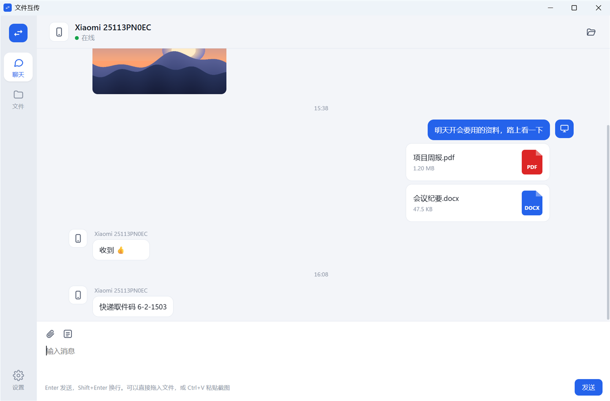
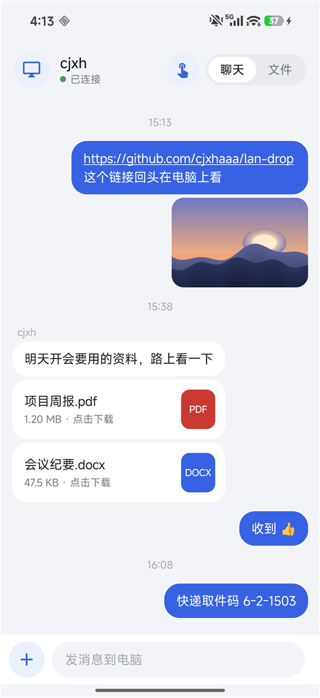
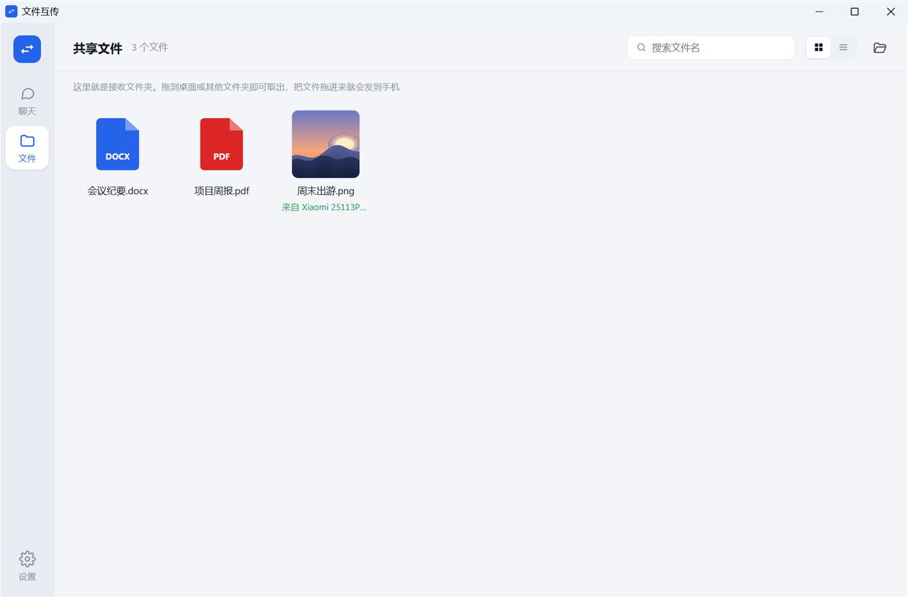
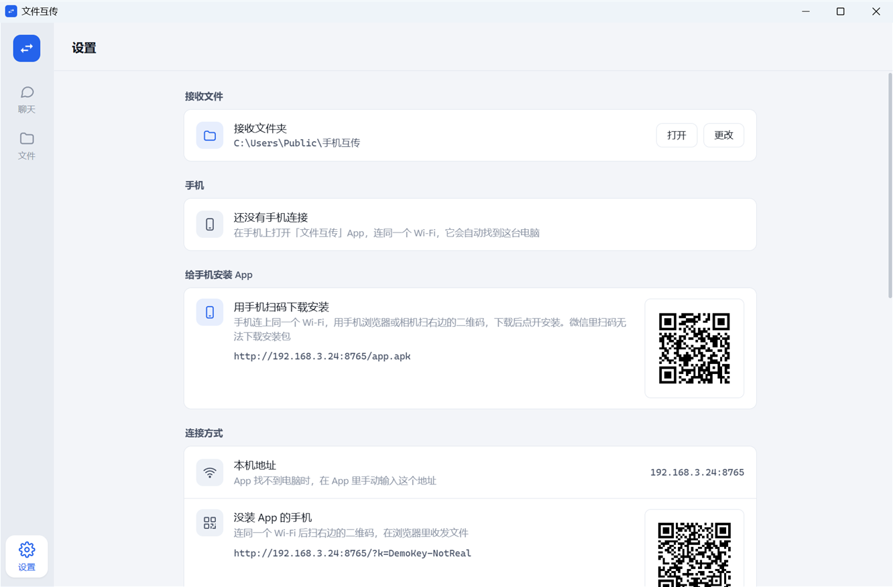
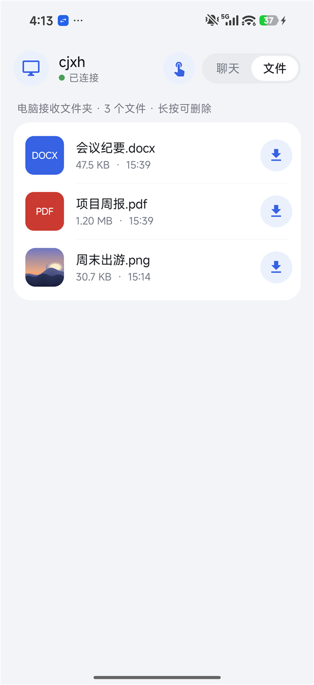
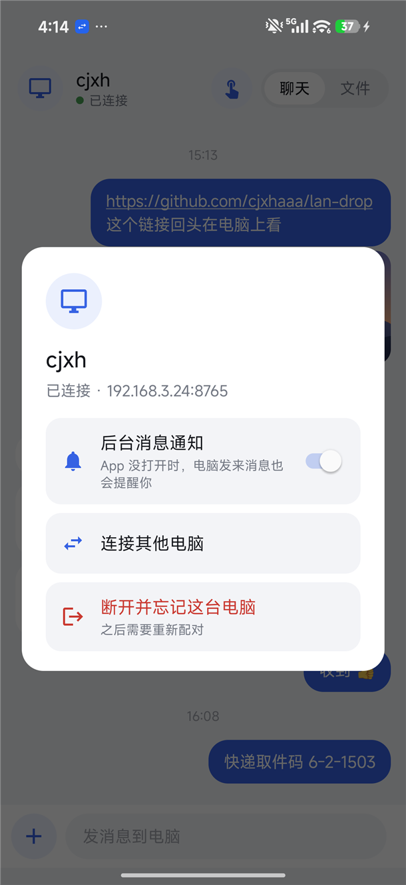
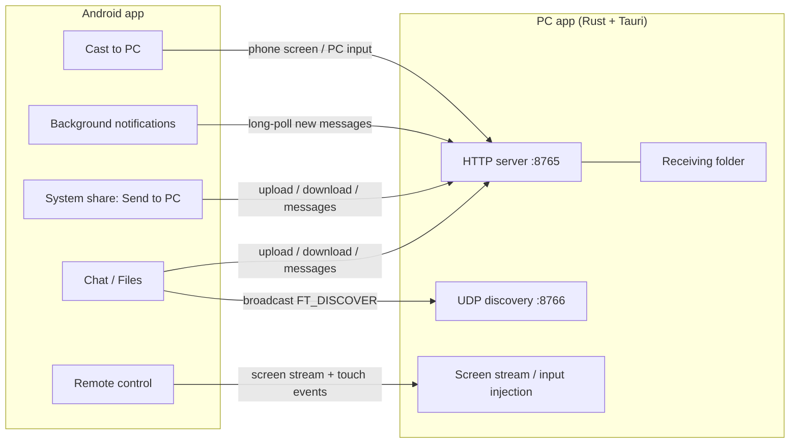

<div align="center">


# LanDrop

**Send files, photos and text between your phone and PC like a chat — and control each other's screen.**<br>
Everything stays on your local Wi-Fi. No server, no account, and the PC side is a single 6 MB exe.

[](https://github.com/cjxhaaa/lan-drop/releases/latest)

[](LICENSE)

**English** · [中文](README.md)

[Download](#download) · [Features](#features) · [Quick start](#quick-start) · [Phone → PC control](#control-your-pc-from-your-phone) · [PC → phone control](#view-and-control-your-phone-from-your-pc) · [FAQ](#faq) · [Build](#build-from-source)

<br>

&nbsp;&nbsp;

</div>

> The app interface is currently in Chinese. Menu names below are given in English with the Chinese label in quotes, so you can find them. An English interface is planned.

## Features

### Transfer things like a chat

Both sides are chat windows. Text, photos and files you send line up in time order — the phone's on one side, the PC's on the other — and the history is kept. Images show as thumbnails, links are clickable.

### Send from anywhere on your phone

In any app (gallery, file manager, WeChat…), tap **Share → Send to PC** (「发送到电脑」). You don't even need to open LanDrop.

### On the PC it works like a folder

- Drag files into the window to send them to your phone; drag photos and files out of the chat onto the desktop or any folder
- Paste screenshots with Ctrl+V to send them
- The Files page is the receiving folder: thumbnails, multi-select, drag out, move to Recycle Bin
- Optional Explorer integration: right-click **Send to → 手机互传**, or pin the folder to Quick Access

### Control your PC from your phone

See your PC screen on the phone. Switch between touchpad mode and direct-touch mode; pinch to zoom, scroll, right-click, drag, and type with your phone keyboard. Three quality levels.

### View and control your phone from your PC

Mirror the phone screen to the PC, following portrait/landscape. With accessibility enabled, mouse clicks, drags, scroll and right-click (Back) become touch actions on the phone, and you can type into the phone with your PC keyboard.

### Notifications on both sides

When the PC window is in the background, new messages pop up as Windows notifications. When the phone app isn't open, a lightweight background service still notifies you.

### Zero setup, still safe

- The phone finds the PC on the LAN automatically, and finds it again if its IP changes
- The first connection must be approved on the PC; after that every request carries a key, so other people on the same network can't connect
- Remote control is off by default; while you're being controlled, the PC shows a clear banner with a one-click disconnect
- Nothing leaves your local network

<table>
  <tr>
    <td width="33%"></td>
    <td width="33%"></td>
    <td width="16%"></td>
    <td width="16%"></td>
  </tr>
  <tr>
    <td align="center">Files: the receiving folder</td>
    <td align="center">Settings: install app by QR, remote control</td>
    <td align="center">Phone: files on the PC</td>
    <td align="center">Phone: connection &amp; notifications</td>
  </tr>
</table>

## Download

Get them from [Releases](https://github.com/cjxhaaa/lan-drop/releases/latest):

| File | Description |
|---|---|
| `LanDrop-x.y.z-windows.exe` | PC app for Windows 10 / 11. Single file, no installation. **The phone app is bundled inside** — scan a QR code on the PC to install it |
| `LanDrop-x.y.z-android.apk` | Phone app for Android 10+. Can also be installed on its own |

## Quick start

1. **PC**: run the exe. On first launch Windows Firewall asks for access — tick **Private networks** and allow.
2. **Install the phone app**: on the PC open **Settings → Install app on phone** (「设置 → 给手机安装 App」) and scan the QR code with your phone's browser or camera.
3. **Connect**: open the phone app. It finds the PC automatically — tap **Connect** (「连接」), then click **Allow** (「允许连接」) on the PC.
4. Done. From now on just open it. Closing the PC window keeps it running in the system tray.

> Phones without the app can still use it: scan the QR code under **Settings → Connection** (「连接方式」) to send and receive files in the phone's browser.

## Control your PC from your phone

Enable **Settings → Remote control → Allow this phone to control the PC** (「允许手机控制这台电脑」), then tap the hand icon at the top of the phone app.

| Gesture | Touchpad mode (default) | Direct mode (「跟手」) |
|---|---|---|
| Finger down | Cursor stays | Cursor jumps under your finger |
| One-finger slide | Move the cursor, with acceleration | Cursor follows your finger |
| Tap / double tap | Click / double-click at the cursor | Click / double-click under your finger |
| Double tap and hold, or long-press then slide | Drag with the left button | Long-press then slide = drag |
| Long-press and release | — | Right-click |
| Two-finger tap | Right-click | Right-click |
| Two-finger vertical swipe | Scroll wheel | Scroll wheel |
| Pinch | Zoom around your fingers (up to 5×) | Same |
| Two-finger drag when zoomed | Pan; the view also follows the cursor | Pan |

The **Tools** (「工具」) button on the right switches mode and quality (Smooth / HD / Original), fits the screen, opens the keyboard (type with your phone's input method, Chinese works too), and sends Esc, Win, Backspace and Enter.

## View and control your phone from your PC

In the phone app tap the PC at the top left → **Cast to PC** (「投屏到电脑」). After you confirm screen recording, the **Phone** (「手机」) page on the PC shows the phone screen.

To control the phone from the PC, turn on **文件互传 · 电脑操作手机** under the phone's **Settings → Accessibility** (the app takes you there the first time). Without it you can still watch, just not control.

| On the PC | On the phone |
|---|---|
| Click | Tap |
| Click and drag | Swipe |
| Press and hold | Long-press |
| Right-click / Esc | Back |
| Scroll wheel | Swipe up / down |
| Type (any input method) | Text goes into the focused field; Backspace and Enter work too |

Back, Home and Recents buttons sit below the screen. The phone shows an ongoing "casting" notification; tap **Stop** to end it at any time.

## FAQ

<details>
<summary><b>The phone can't find the PC</b></summary>

- Make sure LanDrop is running on the PC (look for the tray icon)
- Both devices must be on the same router. "Guest network" or "AP isolation" on some routers blocks devices from seeing each other
- If you dismissed the firewall prompt: Windows Settings → Firewall → Allow an app through firewall, tick **Private** for LanDrop
- Still nothing? Tap **Enter IP** (「输入 IP」) in the app; the address is under **Settings → This PC's address** (「本机地址」) on the PC
</details>

<details>
<summary><b>Clicks don't work on games or Task Manager during remote control</b></summary>

Those programs run as administrator, and Windows doesn't let normal-privilege apps control them. On the PC open **Settings → Remote control** and click **Authorize** (「授权」); confirm once and it works for the rest of the session. A few games' anti-cheat blocks simulated input — those can't be controlled.
</details>

<details>
<summary><b>Accessibility switch is greyed out / "Restricted setting"</b></summary>

Since Android 13, apps installed outside an app store can't enable accessibility by default. Go to Settings → Apps → 文件互传 → top-right menu → **Allow restricted settings**, then turn it on under Accessibility.
</details>

<details>
<summary><b>No notifications on the phone in the background</b></summary>

Xiaomi, Huawei and similar systems restrict background apps. Enable **Autostart** for LanDrop and set battery saver to **No restrictions**. In the app you can toggle it under the PC menu (top left) → **Background notifications**.
</details>

<details>
<summary><b>"Windows protected your PC" when running the exe</b></summary>

This personal open-source project doesn't have a code-signing certificate. Click **More info → Run anyway**, or build it yourself as described below.
</details>

## How it works



- **Discovery**: the app broadcasts a UDP packet on the LAN; the PC replies with its name, port and an ID derived from its key, which is how the phone finds the PC again after an IP change
- **Pairing**: the app asks to pair, the PC shows a confirmation, then hands the phone an access key used on every request
- **Transfer**: plain HTTP, uploads stream straight to disk, downloads support Range (resume)
- **Chat history**: stored in `%APPDATA%\FileTransfer\history.json`; the phone fetches incrementally and long-polls for new messages in the background
- **Phone → PC control**: the PC captures and scales the screen, streams JPEG frames, and replays the phone's gestures with `SendInput`
- **PC → phone control**: the phone captures its screen with MediaProjection and streams it to the PC (shown as MJPEG); PC input goes back over a long-lived connection and is executed by an accessibility service

## Build from source

Requires Windows, [Rust](https://rustup.rs/), Visual Studio Build Tools (C++), and Android Studio (for its bundled JDK and SDK).

```bash
# 1. Build the phone app first (the release APK is bundled into the PC exe)
cd android
gradlew.bat assembleRelease

# 2. Then build the PC app
cd ../desktop/src-tauri
cargo build --release
# Output: desktop/src-tauri/target/release/filetransfer.exe
```

- Point `JAVA_HOME` at `C:\Program Files\Android\Android Studio\jbr` and set `sdk.dir` in `android/local.properties`
- Release signing: set `FT_STORE_FILE`, `FT_STORE_PASSWORD`, `FT_KEY_ALIAS` and `FT_KEY_PASSWORD` in your user-level `~/.gradle/gradle.properties`. Without them the release build falls back to the debug key, which is fine for local testing
- You can build the PC app without the phone app; the exe just won't include "install app by QR"

### Project layout

```
├── desktop/               PC app
│   ├── src-tauri/src/
│   │   ├── main.rs        window, tray, commands called by the UI
│   │   ├── server.rs      HTTP API, UDP discovery, pairing
│   │   ├── state.rs       config, chat history, file names
│   │   ├── remote.rs      screen streaming, input injection, admin input helper
│   │   ├── mirror.rs      phone-to-PC casting
│   │   ├── notify.rs      Windows notifications
│   │   └── system.rs      autostart, "Send to" menu, Quick Access
│   ├── ui/                interface (plain HTML / CSS / JS, no framework)
│   └── web/               browser page for phones without the app
└── android/               phone app (plain Java, no third-party libraries)
    └── app/src/main/java/com/cjxh/filetransfer/
        ├── MainActivity    chat, files, connecting to a PC
        ├── ShareActivity   "Send to PC" in the system share sheet
        ├── RemoteActivity  remote control
        ├── NotifyService   background notifications
        ├── MirrorService   cast to PC
        ├── ControlService  accessibility service that performs PC input
        ├── Net / Store     networking, pairing info
        └── Sheet           shared dialog style
```

## Related projects

These great open-source projects solve similar problems — pick what fits you:

| Project | Strength | Difference from LanDrop |
|---|---|---|
| [LocalSend](https://github.com/localsend/localsend) | LAN file and text sharing on every platform, including iOS, macOS and Linux | One-off sends, no chat history, no remote control |
| [KDE Connect](https://kdeconnect.kde.org/) | Deep phone–PC integration: clipboard, notification sync, remote input and more | More features; both sides need KDE Connect and there's more to configure |
| [scrcpy](https://github.com/Genymobile/scrcpy) | Displays and controls Android on the PC with excellent quality and latency | Needs Developer options and USB debugging, aimed at technical users |
| [RustDesk](https://github.com/rustdesk/rustdesk) | General remote desktop, works by direct IP on a LAN | Focused on remote desktop, not chat-style file transfer |

LanDrop's goal: one app plus one exe, no developer mode, no setup — and the everyday chores of moving things between phone and PC, and controlling one from the other, just work.

## License

[MIT](LICENSE)
