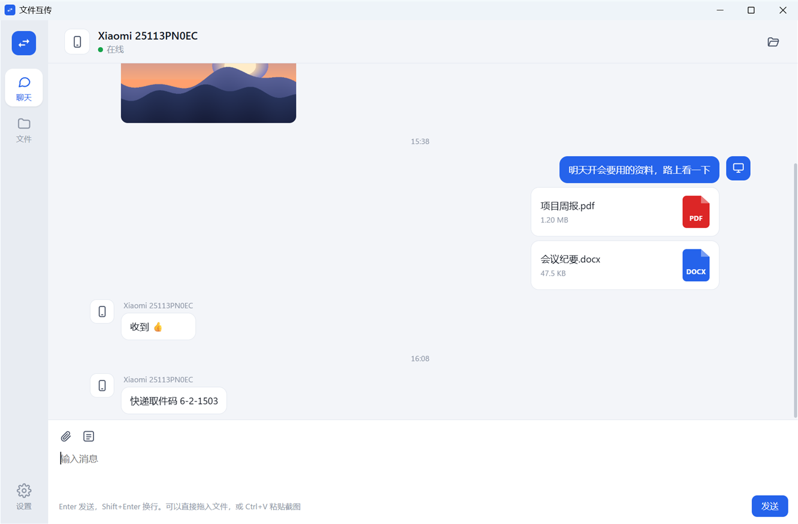
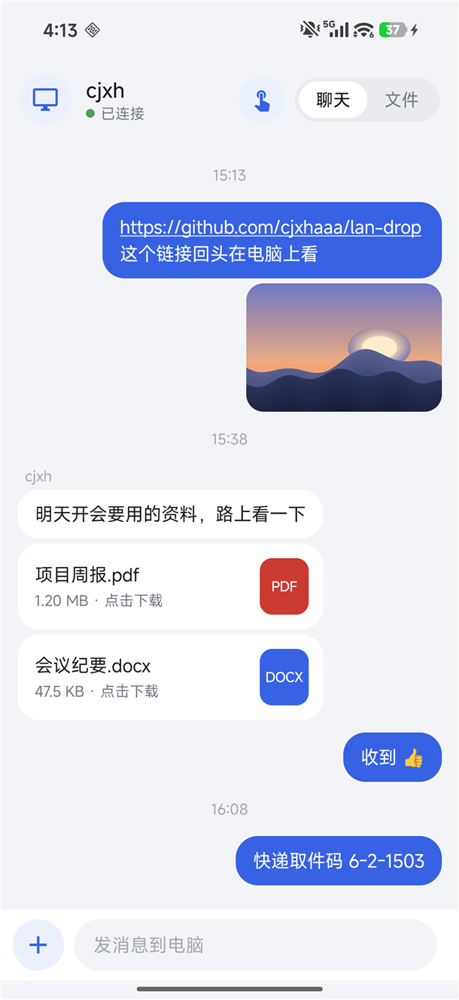
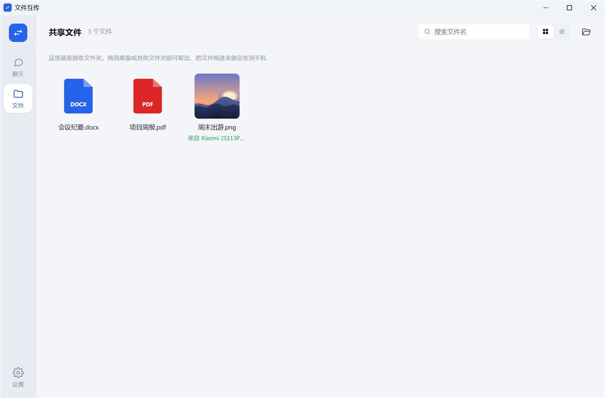
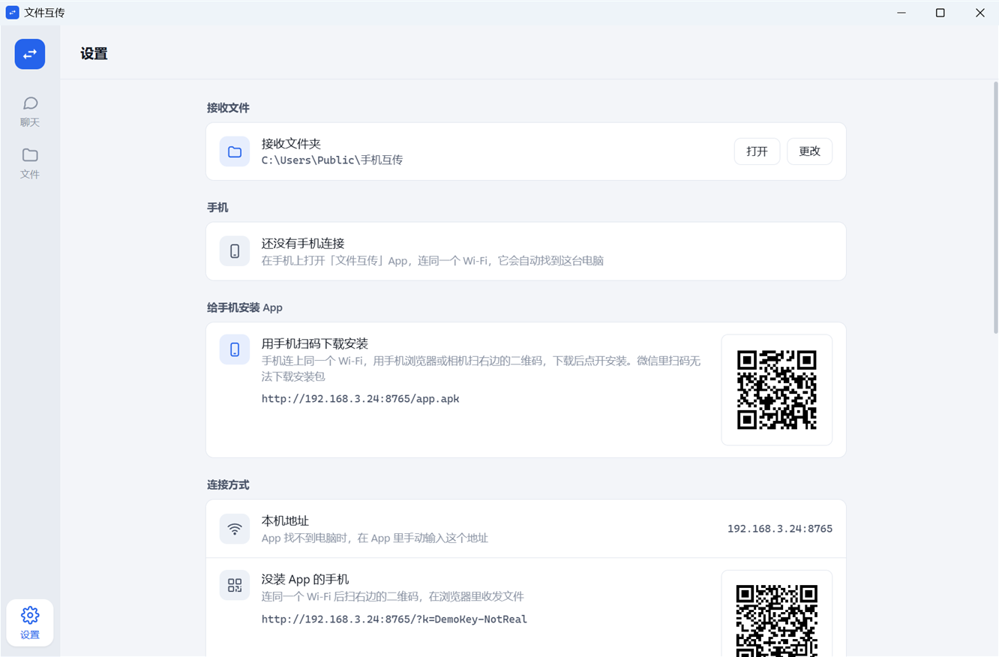
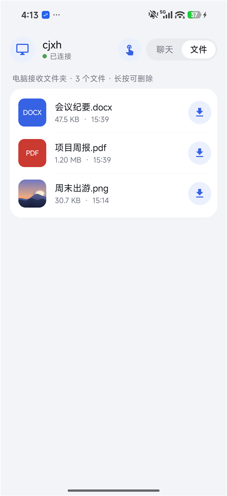
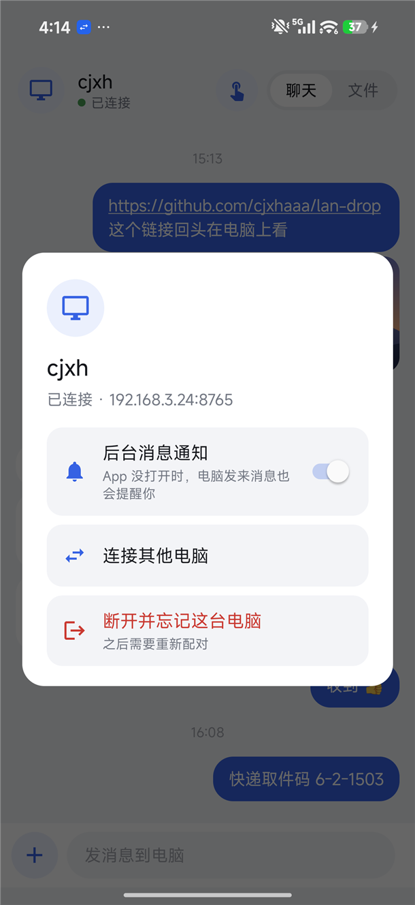
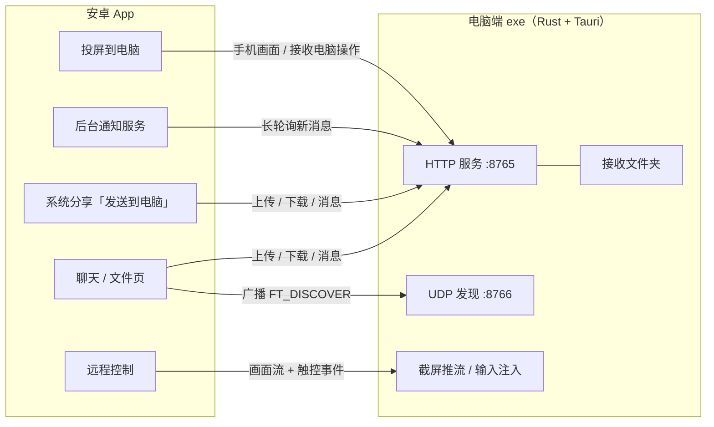

<div align="center">


# LanDrop · 文件互传

**手机和电脑连同一个 Wi-Fi，像微信聊天一样互传文件、图片和文字；手机能远程操作电脑，电脑也能查看和操作手机。**<br>
不经过任何服务器，不用注册登录，电脑端只有一个 6 MB 的 exe。

[](https://github.com/cjxhaaa/lan-drop/releases/latest)

[](LICENSE)

[下载](#下载) · [功能](#功能) · [快速开始](#快速开始) · [手机控制电脑](#用手机控制电脑) · [电脑看手机](#在电脑上查看和操作手机) · [常见问题](#常见问题) · [从源码构建](#从源码构建)

<br>

&nbsp;&nbsp;

</div>

## 功能

**像聊天一样传东西**
两端都是聊天窗口，发过的文字、图片、文件按时间排好，手机发的在一边、电脑发的在另一边，记录会一直保留。图片直接显示缩略图，链接点了就能打开。

**手机上哪里都能发**
在相册、文件管理、微信等任意 App 里点「分享 → 发送到电脑」，不用打开 LanDrop，文件就到电脑了。

**电脑上像操作文件夹一样**
- 把文件拖进窗口就发给手机；聊天里的图片和文件可以直接拖到桌面或任意文件夹
- Ctrl+V 粘贴截图直接发送
- 「文件」页就是接收文件夹，支持缩略图、多选、拖出、移到回收站
- 可加到右键菜单「发送到 → 手机互传」，或固定到资源管理器「快速访问」

**用手机控制电脑**
手机上看电脑屏幕，触控板模式和跟手模式随意切换，支持双指缩放、滚动、右键、拖动和中文输入，三档清晰度可选。

**在电脑上查看和操作手机**
手机投屏到电脑，画面跟随横竖屏；开启无障碍后，鼠标点击、拖动、滚轮、右键返回都会变成手机上的操作，还能直接用电脑键盘往手机里打字。

**及时提醒**
电脑窗口在后台时右下角弹系统通知；手机 App 没打开时，后台服务也会推送电脑发来的消息。

**零配置、够安全**
- 手机自动在局域网里找到电脑，电脑 IP 变了也会自己找回
- 第一次连接要在电脑上点「允许」，之后凭密钥通信，同一网络里的其他人连不上
- 远程控制默认关闭；被控制时电脑上有醒目的提示条，随时一键断开
- 所有数据只在你的局域网里传输

<table>
  <tr>
    <td width="33%"></td>
    <td width="33%"></td>
    <td width="16%"></td>
    <td width="16%"></td>
  </tr>
  <tr>
    <td align="center">文件页：接收文件夹</td>
    <td align="center">设置：扫码装 App、远程控制</td>
    <td align="center">手机：电脑上的文件</td>
    <td align="center">手机：连接与通知</td>
  </tr>
</table>

## 下载

到 [Releases](https://github.com/cjxhaaa/lan-drop/releases/latest) 下载：

| 文件 | 说明 |
|---|---|
| `LanDrop-x.y.z-windows.exe` | 电脑端，Windows 10 / 11，单文件免安装。**手机 App 已经打包在里面**，装好电脑端后用手机扫码就能安装 |
| `LanDrop-x.y.z-android.apk` | 手机端，Android 10 及以上。也可以单独下载安装 |

## 快速开始

1. **电脑**：双击 exe。第一次运行时 Windows 防火墙会弹窗，勾选 **专用网络** 并点「允许访问」。
2. **手机装 App**：电脑端「设置 → 给手机安装 App」，用手机浏览器或相机扫码下载安装（微信扫码不能下载安装包）。
3. **连接**：打开手机 App，它会自动找到电脑，点「连接」，再在电脑弹出的窗口里点「允许连接」。
4. 完成。之后打开就能用，电脑关窗口后会缩到系统托盘继续接收。

> 没装 App 的手机也能用：电脑端「设置 → 连接方式」里扫码，在手机浏览器里收发文件。

## 用手机控制电脑

先在电脑端「设置 → 远程控制」打开「允许手机控制这台电脑」，然后在手机 App 顶部点手指图标。

| 手势 | 触控板模式（默认） | 跟手模式 |
|---|---|---|
| 手指按下 | 鼠标不动 | 鼠标立刻跳到手指位置 |
| 单指滑动 | 移动鼠标，滑得快走得远 | 鼠标跟着手指走 |
| 轻点 / 快速点两下 | 在鼠标位置单击 / 双击 | 在手指位置单击 / 双击 |
| 点两下按住滑动，或长按后滑动 | 按住左键拖动 | 长按后滑动 = 拖动 |
| 长按不动松开 | — | 右键 |
| 双指轻点 | 右键 | 右键 |
| 双指上下滑 | 滚轮 | 滚轮 |
| 双指捏合 / 张开 | 以两指中间为中心缩放画面（最大 5 倍） | 同左 |
| 放大后双指拖动 | 平移画面，鼠标移出视野时画面自动跟随 | 平移画面 |

右侧「工具」里可以切换模式、清晰度（流畅 / 高清 / 原画）、适应屏幕，打开键盘直接用手机输入法打字（中文也行），以及 Esc、Win、退格、回车等按键。

## 在电脑上查看和操作手机

在手机 App 里点左上角的电脑 →「投屏到电脑」，系统确认录屏后，电脑端左侧「手机」页就会显示手机画面。

想在电脑上操作手机，需要在手机「设置 → 无障碍」里打开「文件互传 · 电脑操作手机」（第一次投屏时 App 会带你去）。不开也能看，只是不能操作。

| 电脑上的操作 | 手机上的效果 |
|---|---|
| 单击 | 点按 |
| 按住拖动 | 滑动 |
| 按住不动再松开 | 长按 |
| 右键 / Esc | 返回 |
| 滚轮 | 上下滑动 |
| 直接打字（支持中文输入法） | 输入到手机当前的输入框，退格和回车也可以 |

画面下方还有「返回」「主页」「多任务」按钮。手机通知栏会一直显示「正在投屏」，点「停止投屏」随时结束。

## 常见问题

<details>
<summary><b>手机找不到电脑</b></summary>

- 确认电脑上 LanDrop 正在运行（托盘里有图标）
- 手机和电脑要连在同一个路由器下。部分路由器的「访客网络」或「AP 隔离」会阻止设备互相访问
- 第一次运行时防火墙弹窗如果点了取消：Windows 设置 → 防火墙 → 允许应用通过防火墙，勾选 LanDrop 的「专用」
- 实在找不到，点 App 里的「输入 IP」，地址在电脑端「设置 → 本机地址」
</details>

<details>
<summary><b>远程控制时点游戏 / 任务管理器没反应</b></summary>

这些程序以管理员身份运行，Windows 不允许普通权限的程序操作它们。在电脑端「设置 → 远程控制」点「授权」，确认一次后本次运行期间都能操作。少数游戏的反作弊会屏蔽模拟输入，这种情况无法控制。
</details>

<details>
<summary><b>无障碍里找不到开关，或提示「受限设置」</b></summary>

安卓 13 起，不是从应用商店安装的 App 默认不能开启无障碍。到 设置 → 应用 → 文件互传 → 右上角菜单 →「允许受限制的设置」，再回到无障碍里打开即可。
</details>

<details>
<summary><b>手机收不到后台通知</b></summary>

小米、华为等系统会限制后台运行。在系统设置里给 LanDrop 打开「自启动」，并把省电策略设为「无限制」。App 内可以在「点左上角电脑 → 后台消息通知」里开关。
</details>

<details>
<summary><b>运行 exe 时提示「Windows 已保护你的电脑」</b></summary>

个人开源项目没有购买代码签名证书，点「更多信息 → 仍要运行」即可。介意的话可以按下面的方法自己编译。
</details>

## 工作原理



- **发现**：App 在局域网广播 UDP 包，电脑回复自己的名字、端口和 ID（ID 由密钥派生，电脑换 IP 后据此找回）
- **配对**：App 请求配对，电脑弹窗确认后把访问密钥交给手机，之后所有请求都带着密钥
- **传输**：普通 HTTP，上传流式写盘，下载支持断点续传（Range）
- **聊天记录**：保存在 `%APPDATA%\FileTransfer\history.json`；手机端增量拉取，后台用长轮询等待新消息
- **远程控制**：截屏缩放后编码为 JPEG 连续推送，手机把手势转换成鼠标键盘事件，电脑用 `SendInput` 执行
- **电脑看手机**：手机用系统录屏接口（MediaProjection）截取画面推给电脑，电脑界面以 MJPEG 显示；电脑的操作通过一条长连接发回手机，由无障碍服务执行手势和输入

## 从源码构建

需要 Windows、[Rust](https://rustup.rs/)、Visual Studio Build Tools（C++）和 Android Studio（用它自带的 JDK 和 SDK）。

```bash
# 1. 先编译手机 App（release 版会被打包进电脑端 exe）
cd android
gradlew.bat assembleRelease

# 2. 再编译电脑端
cd ../desktop/src-tauri
cargo build --release
# 输出：desktop/src-tauri/target/release/filetransfer.exe
```

- 编译 App 前把 `JAVA_HOME` 指向 `C:\Program Files\Android\Android Studio\jbr`，并在 `android/local.properties` 里写上 `sdk.dir`
- 发布签名：在用户目录的 `~/.gradle/gradle.properties` 里配置 `FT_STORE_FILE`、`FT_STORE_PASSWORD`、`FT_KEY_ALIAS`、`FT_KEY_PASSWORD`；不配置时 release 版用调试签名，方便自己编译测试
- 没有先编译 App 也能编译电脑端，只是 exe 里不带「扫码安装 App」

### 项目结构

```
├── desktop/               电脑端
│   ├── src-tauri/src/
│   │   ├── main.rs        窗口、托盘、给界面调用的命令
│   │   ├── server.rs      HTTP 接口、UDP 发现、配对
│   │   ├── state.rs       配置、聊天记录、文件名处理
│   │   ├── remote.rs      截屏推流、鼠标键盘注入、管理员权限输入助手
│   │   ├── mirror.rs      手机投屏到电脑
│   │   ├── notify.rs      Windows 系统通知
│   │   └── system.rs      开机自启、右键「发送到」、快速访问
│   ├── ui/                界面（原生 HTML / CSS / JS，无框架）
│   └── web/               给没装 App 的手机用的浏览器页面
└── android/               手机端（纯 Java，不依赖任何第三方库）
    └── app/src/main/java/com/cjxh/filetransfer/
        ├── MainActivity    聊天、文件页、连接电脑
        ├── ShareActivity   系统分享菜单里的「发送到电脑」
        ├── RemoteActivity  远程控制
        ├── NotifyService   后台通知
        ├── MirrorService   投屏到电脑
        ├── ControlService  无障碍服务：执行电脑发来的操作
        ├── Net / Store     网络请求、配对信息
        └── Sheet           统一风格的弹窗
```

## 相关项目

这些优秀的开源项目解决了相近的问题，可以按需求选择：

| 项目 | 擅长 | 和 LanDrop 的区别 |
|---|---|---|
| [LocalSend](https://github.com/localsend/localsend) | 全平台（含 iOS、macOS、Linux）局域网互传文件和文字 | 以单次发送为主，没有聊天记录，也没有远程控制 |
| [KDE Connect](https://kdeconnect.kde.org/) | 手机电脑深度联动：剪贴板、通知同步、远程输入等 | 功能更全，两端都要装 KDE Connect，配置项也更多 |
| [scrcpy](https://github.com/Genymobile/scrcpy) | 在电脑上显示和控制安卓，画质和延迟都很出色 | 需要打开开发者模式和 USB 调试，更适合技术用户 |
| [RustDesk](https://github.com/rustdesk/rustdesk) | 通用远程桌面，局域网内也能直接用 IP 连接 | 专注远程桌面，不负责文件和聊天式互传 |

LanDrop 想做的是：一个 App 加一个 exe，不用开发者模式、不用额外配置，把「互传东西」和「手机电脑互相操作」这几件日常小事做顺手。

## 开源协议

[MIT](LICENSE)
